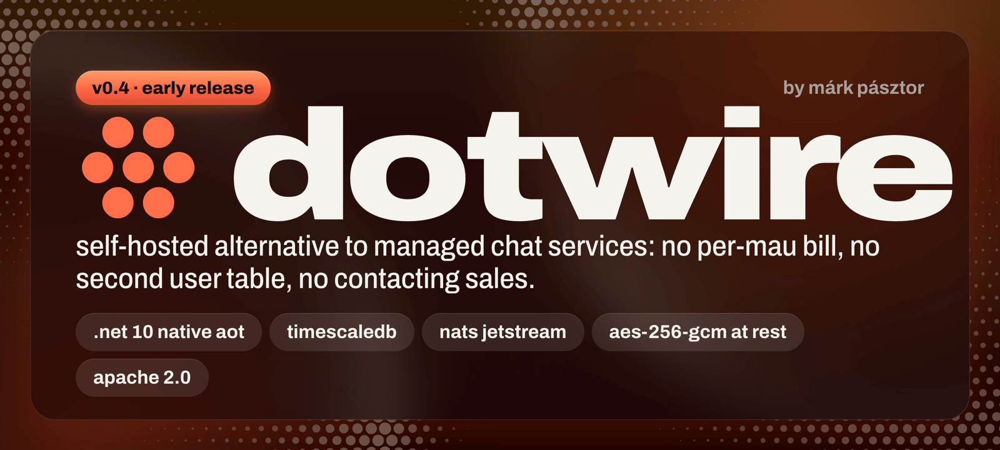
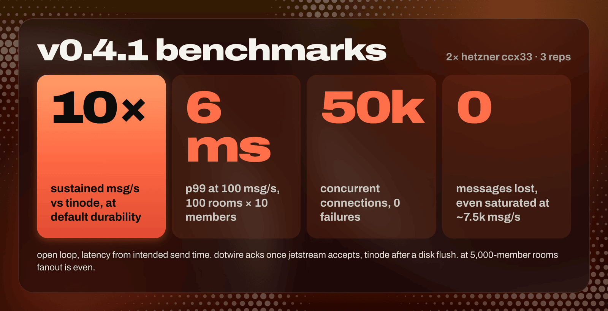

[](https://dotnet.microsoft.com/)
[](https://www.timescale.com/)
[](https://nats.io/)
[]()
[](LICENSE)
[](https://doi.org/10.5281/zenodo.24406317)

**[Key highlights](#key-highlights) · [Architecture](#architecture) · [Quickstart](#quickstart) · [Benchmarks](#benchmarks) · [Official SDKs](#official-sdks) · [Docs](#docs) · [Contributing](#contributing) · [License](#license)**

dotwire is a free, open-source chat layer you embed in your own application. Your app keeps owning its users and signs the JWTs; dotwire verifies them and handles realtime delivery, message persistence and ordering, and a tamper-evident audit log. It ships APIs and SDKs, not a chat UI, so you build the interface your product needs.

> **Early release (v0.4).** APIs and deployment guidance may still change, and dotwire isn't used in production yet, so evaluate it carefully before relying on it. Feedback and issues are welcome.

---

<a id="key-highlights"></a>


* **Native AOT:** Compiled ahead-of-time with .NET 10 Native AOT into a standalone binary.
* **Stateless Host-Owned Identity:** Authenticates via host-signed RS256 JWTs with authoritative database role cross-checks. dotwire owns zero user tables.
* **Decoupled Persistence Pipeline:** Client send acknowledgements (`202 Accepted`) confirm NATS JetStream persistence, independently of background TimescaleDB batch ingestion.
* **Shard-Key Discipline:** Hot-path queries include `room_id`; TimescaleDB hypertables support time-based retention through chunk drops.
* **Envelope Encryption at Rest:** Payloads are encrypted with AES-256-GCM (`nonce(12) ‖ ciphertext ‖ tag(16)`) at the gateway before publishing to JetStream or writing to disk. Key IDs travel alongside envelopes for zero-downtime key rotation.
* **Tamper-Evident Audit Chain:** Append-only compliance log hash-chained with SHA-256, anchored by periodic checkpoints, verifiable via `GET /audit/verify`, and protected with database-level revoked grants and guard triggers.
* **Compliance Surface:** Redaction, DSAR export, and configurable retention (Postgres chunk drops + JetStream `MaxAge`) via the admin API and both host SDKs.
* **Webhooks & SSE:** Optional presend/postsend webhook call-outs for host-side moderation, and a resumable Server-Sent Events read path alongside SignalR.
* **Per-Node Rate Limiting:** In-process token-bucket limits on send, read, admin, and hub routes — no external dependency.

---

<a id="architecture"></a>


---

<a id="quickstart"></a>


The quickstart runs the full stack with Docker Compose.

### 1. Prerequisites
* [Docker](https://docs.docker.com/get-docker/) & Docker Compose
* OpenSSL (for generating test keys)

### 2. Configure Environment
```bash
# Clone the repository
git clone https://github.com/pasztor-mark/dotwire.git
cd dotwire

# Create .env from template
cp .env.example .env

# Generate a 32-byte AES-256-GCM symmetric encryption key
echo "Dotwire__Encryption__Keys__k1=$(openssl rand -base64 32)" >> .env

# Generate dev RSA private/public keypair for RS256 token minting
openssl genpkey -algorithm RSA -out dev-jwt.key -pkeyopt rsa_keygen_bits:2048
openssl rsa -pubout -in dev-jwt.key -out dev-jwt.pub

# Set test passwords in .env
echo "POSTGRES_PASSWORD=dotwire_dev_password" >> .env
echo "POSTGRES_APP_PASSWORD=dotwire_app_password" >> .env
echo "Auth__Issuer=dev-host" >> .env
echo "Auth__Audience=dotwire" >> .env
echo "Auth__Keys__dev=\"$(awk '{printf "%s\\n",$0}' dev-jwt.pub)\"" >> .env
```

### 3. Launch Stack
```bash
docker compose up -d --build
```

Omit `--build` to run the published image, `ghcr.io/pasztor-mark/dotwire:<version>` (`linux/amd64` and `linux/arm64`; set `DOTWIRE_VERSION`, default `0.5.0`).

The compose stacks publish plain HTTP on `127.0.0.1` only. Before exposing dotwire, put TLS in front of it, set `Cors:AllowedOrigins` and `AllowedHosts` to your real origins and host names, keep `ConnectionStrings:PostgresMigrator` on the migrating node only, and for `compose.multinode.yaml` set `NATS_USER`, `NATS_PASSWORD`, `POSTGRES_REPLICATION_PASSWORD` and `HAPROXY_STATS_PASSWORD` in `.env`. Connection strings in compose `environment:` are visible through `docker inspect`; in production supply them from your secret store instead. Point the host SDKs at an `https` `baseUrl` outside localhost. See ARCHITECTURE.md, "Deployment posture".

### 4. Verify Health
```bash
curl http://localhost:8080/healthz
# Response: 200 OK
```

### 5. Seed Test Room & Users
```bash
docker compose exec postgres psql -U dotwire -d dotwire -c "
  INSERT INTO user_roles (user_id, role) VALUES ('user-1', 'member'), ('admin-user', 'admin') ON CONFLICT DO NOTHING;
  INSERT INTO room_members (room_id, user_id) VALUES ('00000000-0000-0000-0000-000000000001', 'user-1') ON CONFLICT DO NOTHING;
"
```

### 6. Send Your First Message
Follow the [`@dotwire/host`](packages/host/README.md) and [`@dotwire/client`](packages/client/README.md) quickstarts to mint a token and connect. For this stack, use `dev-jwt.key` as the private key, with key ID `dev`, issuer `dev-host`, and audience `dotwire`.

---

<a id="benchmarks"></a>




Open-loop load, with latency measured from the intended send time. dotwire acks once JetStream accepts a message; Tinode acks after a disk flush. At 5,000-member rooms, fanout is even.

[](https://doi.org/10.5281/zenodo.24406317) Methodology, raw data and notebook: [dw-benchmarks](https://github.com/pasztor-mark/dw-benchmarks) · [full results](https://dotwire.pasztormark.dev/docs/benchmarks)

---

<a id="official-sdks"></a>


Coding agents integrating chat into a host app can start with the [SDK guide](docs/SDK_AGENT_GUIDE.md), which maps each package to its responsibility and shows the participant lookup flow.

| Package | Environment | Purpose | Documentation |
|---|---|---|---|
| [`@dotwire/client`](packages/client) | Browser / Web / React / Vue / Node.js | Real-time chat, scoped rooms, SignalR subscription with gap-fill, typing, presence, history | [Client README](packages/client/README.md) |
| [`@dotwire/host`](packages/host) | Node.js / Next.js / Express Backend | RS256 JWT minting, zero-SQL room provisioning, role administration, system messages, webhooks, moderation, audit, retention, DSAR | [Host README](packages/host/README.md) |
| [`@dotwire/react`](packages/react) | React 18+ | `DotwireProvider`, `useRoom`, `useTyping`, `usePresence`, `useConnectionState` hooks over `@dotwire/client` | [React README](packages/react/README.md) |
| [`Dotwire.Host`](Dotwire.Host) | .NET 8/9/10 C# Backend | C# RS256 JWT minting, `Presend`/`PostSend` moderation hooks, batched async review, redaction, webhooks, audit, retention, DSAR | [.NET Host README](Dotwire.Host/README.md) |

---

<a id="docs"></a>


Browse the full docs site at [https://dotwire.pasztormark.dev/docs](https://dotwire.pasztormark.dev/docs).

The architecture is governed by normative contracts:

1. **[PRODUCT.md](PRODUCT.md)** — Product scope, user personas, and the hard out-of-scope contract.
2. **[ARCHITECTURE.md](ARCHITECTURE.md)** — Write path, read path, NATS backplane, node roles, and fanout disciplines.
3. **[AUTH.md](AUTH.md)** — Token specification, claims format, key rotation, and 4-stage authorization pipeline.
4. **[COMPLIANCE.md](COMPLIANCE.md)** — Compliance controls inventory, encryption, redaction, and audit logging.
5. **[AGENTS.md](AGENTS.md)** — Hard architectural conventions for AI pair programmers and human contributors.

Upgrading? See **[UPGRADING.md](UPGRADING.md)** (0.3 to 0.4 has no breaking changes; 0.2 to 0.3 does).

---

<a id="contributing"></a>


Issues, bug reports, and pull requests are welcome. dotwire is early, so feedback from real integration attempts is the most useful contribution of all.

See **[CONTRIBUTING.md](CONTRIBUTING.md)** for the conventions to follow, how to build and test locally, and the pull request checklist. Report security issues privately as described in **[SECURITY.md](SECURITY.md)**, and follow the **[Code of Conduct](CODE_OF_CONDUCT.md)**.

---

## Recommended settings by scenario

Pick the row that matches your expected traffic; no benchmarking is needed. Defaults suit most deployments, so change only what your row says. Values marked *untested* are guidance, not benchmark results. Every key is listed in [`.env.example`](.env.example).

| Scenario | Set | Leave at default |
|---|---|---|
| **Local development, or most apps (up to about 100 concurrent REST clients, up to a few thousand messages/s)** | `Dotwire__Role=All`. Nothing else. The v0.4.1 benchmark reached ~7.5k msg/s with 0 messages lost before batching existed. | Auth batching and cache off, rate limits on. |
| **Production, single node** | `Cors__AllowedOrigins__0`, the real `AllowedHosts`, TLS in front. A short `Auth__MaxTokenLifetimeMinutes` (e.g. `15`). `Dotwire__DisableDebugLogging=true`. | Auth batching and cache off. |
| **About 100 to 1,000 concurrent REST clients** | `Dotwire__AuthBatching__Enabled=true`. The read pool in compose (`Maximum Pool Size=100`) is enough. | `MaxInFlight=2` and `MaxBatchSize=512`. Raise `MaxInFlight` to 8 to 16 only if the database is on another network (*untested*). |
| **1,000+ concurrent REST clients** | Batching on, plus a larger `Maximum Pool Size` on `PostgresRead` (e.g. `200`, *untested*) with Postgres `max_connections` above all pools combined. | The cache, unless you accept delayed revocation (next row). |
| **Read-heavy, can accept delayed revocation** | `Dotwire__AuthCacheSeconds` of `1` to `5`. A revoked user can keep REST access for up to that many seconds if a broadcast is lost. The node's NATS user must be allowed to subscribe to `room.*.ephemeral.revoked`. | Off unless you accept that window. |
| **Load testing** | Raise `Dotwire__RateLimits__Send__PermitLimit` (and `TokensPerPeriod`) so the per-user limit is not what you measure. `Dotwire__DisableAllLogging=true` for peak numbers only. | Production runs keep rate limits on. |
| **Beyond one node (sustained above ~7k messages/s, or ~100k+ connections)** | `Dotwire__Role=Gateway` on socket nodes, `Api` on REST/admin nodes. Gateways hold no migrator credentials. Point the read pool at the primary or a synchronous replica if demotions must apply at once. | Batching and cache stay per-node and off unless needed; the cache runs on `All` and `Api` nodes only. |
| **Compliance-strict** | `Dotwire__Retention__MessagesDays` (manage it here or through the admin API, not both). `Dotwire__Encryption__AllowLegacyEnvelopes=false` on new installs, or once no legacy rows remain. Archive `audit_checkpoints` off the database. | `RateLimits__Enabled=true`, auth cache off, encryption keys per [COMPLIANCE.md](COMPLIANCE.md). |
| **Agents / harnesses** | `Dotwire__Sse__Enabled=true` (default). Raise `Dotwire__Sse__BufferSize` if consumers get disconnected as laggards. | `MaxReplayRows` and `ReplayPageSize`. |
| **Moderation through webhooks** | `Dotwire__Webhooks__Secret`, `https` URLs, `Presend__FailPolicy=Closed` if unmoderated content is unacceptable, `Open` if availability matters more. Size `Presend__TimeoutMs` to your endpoint's p99. | `PostSend__QueueCapacity` and `MaxAttempts`. |

Keep these at their defaults in every scenario: `Nats__RoomsSubjectFilter`, NATS stream, subject and consumer names, `Dotwire__Encryption__Keys`, the `AllowInsecure*` switches and the `nofile`, GC and socket-backlog settings.

## Performance notes

* **REST auth batching is opt-in.** `Dotwire__AuthBatching__Enabled` (default `false`) groups concurrent REST room-authorization lookups into one query, with at most `Dotwire__AuthBatching__MaxInFlight` (default `2`) queries in flight per node. Requests are grouped only when they have to wait for a free slot, so a small limit batches more and a large limit rarely batches at all. A local test showed no difference at light load and clear gains at 128 to 1024 concurrent requests (about +44%, +63% and +38% throughput with a limit of 16). Turn it on from about 100 concurrent REST clients upward (see "Recommended settings by scenario"). Raise `MaxInFlight` (8 to 16, untested guidance) if lookups are slow, for example a database on another network.
* **Logging costs CPU under load.** `Dotwire__DisableDebugLogging=true` drops Trace, Debug and Information logs; `Dotwire__DisableAllLogging=true` turns all logging off.

## Metrics

dotwire pushes OpenTelemetry metrics over OTLP. Metrics are on by default. Traces are opt-in (see "Tracing"). Logs are not exported. No room, message, user or sender id, no subject, no SQL text and no message content is ever exported as a metric or tag.

* **Turn off:** `Dotwire__DisableMetrics=true`. With it set, no meter provider is registered and the JetStream poller does not run.
* **Exporter:** the standard OTel variables apply: `OTEL_EXPORTER_OTLP_ENDPOINT` (default `http://localhost:4317`), `OTEL_EXPORTER_OTLP_PROTOCOL`, `OTEL_EXPORTER_OTLP_HEADERS`, `OTEL_METRIC_EXPORT_INTERVAL`, `OTEL_SERVICE_NAME` and `OTEL_RESOURCE_ATTRIBUTES`.
* **Compose:** inside a container, `localhost` is the container itself. `compose.yaml` and `compose.multinode.yaml` pass `OTEL_EXPORTER_OTLP_ENDPOINT` through with the default, so set it to your collector's address.
* **Multi-node:** the JetStream gauges describe the cluster, not one node. Every `All` and `Api` node runs the poller and reports the same values, so take `max()` across nodes, never a sum. Each process is its own series (`service.instance.id`).

Instruments (meter `Dotwire`):

| Instrument | Kind | Unit | Tags | Recorded at |
|---|---|---|---|---|
| `dotwire.jetstream.consumer.pending` | ObservableGauge<long> | `{message}` | `stream`, `consumer` | poller snapshot: `NumPending + NumAckPending` |
| `dotwire.jetstream.consumer.oldest_pending.age` | ObservableGauge<double> | `s` | `stream`, `consumer` | poller snapshot; `0` when pending is 0 |
| `dotwire.jetstream.stream.bytes` | ObservableGauge<long> | `By` | `stream` | poller snapshot: `StreamState.Bytes` |
| `dotwire.jetstream.stream.messages` | ObservableGauge<long> | `{message}` | `stream` | poller snapshot: `StreamState.Messages` |
| `dotwire.jetstream.stream.max_bytes` | ObservableGauge<long> | `By` | `stream` | server `StreamConfig.MaxBytes`, only when > 0 (AUDIT) |
| `dotwire.jetstream.stream.max_age` | ObservableGauge<double> | `s` | `stream` | server `StreamConfig.MaxAge`, only when > 0 (ROOMS) |
| `dotwire.audit.writer.lock_held` | ObservableGauge<int> | `1` | none | `AuditWriterService`: 1 while the advisory lock is held, else 0 |
| `dotwire.audit.unavailable` | Counter<long> | `{response}` | none | `ApiResults.AuditUnavailable()` |
| `dotwire.rejections` | Counter<long> | `{rejection}` | `transport` (`hub`, `rest`, `sse`), `reason` (`rate_limited`, `too_many_connections`, `busy`), `operation` (`connect`, `subscribe`, `unsubscribe`, `send`, `audit_verify`) | sites that bypass the rate-limit middleware: `RoomHub.OnConnectedAsync`, `RoomHub.Send`, `HubRateLimitFilter.InvokeMethodAsync`, `SendRateLimitFilter` (REST send when `HubSend:Enabled=true`), the SSE connection cap in `Events`, the full-verify gate in `Audit` |
| `dotwire.sse.active_connections` | ObservableGauge<long> | `{connection}` | none | `RoomInterestManager`: sum of `_sseChannels` per-room counts |
| `dotwire.webhook.presend.results` | Counter<long> | `{call}` | `outcome` (`allowed`, `allowed_with_rewrite`, `rejected`, `unavailable`, `failed_open`) | `PresendWebhookClient.EvaluateAsync` / `Unavailable` |
| `dotwire.webhook.postsend.dropped` | Counter<long> | `{event}` | `reason` (`queue_bytes`, `queue_full`, `max_attempts`) | `PostSendWebhookService` |
| `dotwire.message.send.duration` | Histogram<double> | `s` | `transport` (`hub`, `rest`), `outcome` (`accepted`, `rejected`, `unavailable`) | `MessageSend.SendAsync`: validation, presend, encrypt, JetStream ack and live republish. Admin injection is not included |
| `dotwire.jetstream.publish.duration` | Histogram<double> | `s` | `outcome` (`ok`, `error`) | `MessagePublisher`: the JetStream publish and ack only, for member sends and admin injection |
| `dotwire.fanout.lag` | Histogram<double> | `s` | none | `RoomInterestManager`: message timestamp (set by the sending node before the publish) to local fanout. Includes clock skew between nodes |
| `dotwire.fanout.dropped` | Counter<long> | `{event}` | `transport` (`hub`, `sse`), `reason` (`slow_consumer`, `ephemeral_shed`) | `RoomInterestManager`: `slow_consumer` is an event that found the client's buffer full, which disconnects that client; `ephemeral_shed` is a typing/presence event skipped because the buffer was half full |
| `dotwire.auth.cache.lookups` | Counter<long> | `{lookup}` | `result` (`hit`, `miss`) | `RoomAccessFilter`, only when `Dotwire__AuthCacheSeconds` > 0 |
| `dotwire.auth.lookup.duration` | Histogram<double> | `s` | `path` (`direct`, `batched`) | `RoomAccessFilter`: membership lookups that missed the cache |
| `dotwire.auth.batch.size` | Histogram<int> | `{lookup}` | none | `AccessLookupBatcher`, only when `Dotwire__AuthBatching__Enabled=true` |

Built-in meters are exported too: ASP.NET Core (`Microsoft.AspNetCore.Hosting`, Kestrel, SignalR connections, rate limiting, which includes `aspnetcore.rate_limiting.requests` for middleware rejections), `System.Net.Http`, `System.Runtime`, `Npgsql` and `NATS.Net`. Third-party tags are scrubbed by views: `NATS.Net` `messaging.client.*` is dropped (it carries subjects), `nats.client.*` has no tags, and `db.client.*` keeps only `db.client.connection.state`, `db.client.connection.pool.name`, `db.operation.name` and `error.type`. The pool name is `read` or `write`: both data sources are given a fixed name, because without one Npgsql fills that tag with connection-string fragments.

A JetStream gauge that disappears means the poller is failing or NATS is unreachable. Alert on its absence.

In Prometheus (via OTLP) names become snake case with unit suffixes: `dotwire.rejections` is `dotwire_rejections_total`, `dotwire.jetstream.consumer.oldest_pending.age` is `dotwire_jetstream_consumer_oldest_pending_age_seconds`, and `dotwire.audit.writer.lock_held` is `dotwire_audit_writer_lock_held_ratio`. `service.name` and `service.instance.id` become the `service_name` and `service_instance_id` labels; the node role is on `target_info` as `dotwire_node_role`.

### Local dashboard (Grafana)

`compose.observability.yaml` adds a single `grafana/otel-lgtm` container (OTel Collector, Prometheus, Tempo, Loki and Grafana) with a provisioned **dotwire** dashboard: health stats with the thresholds below, traffic and latency by route, connections, send duration, JetStream ack time, fanout lag and drops, rejections and webhooks, JetStream lag, database (per pool) and .NET runtime, auth lookups, and recent traces.

```bash
OTEL_EXPORTER_OTLP_ENDPOINT=http://lgtm:4317 Dotwire__EnableTracing=true \
  docker compose -f compose.yaml -f compose.observability.yaml up -d
```

Open http://localhost:3000 and go to Dashboards → dotwire. The same overlay works with `compose.multinode.yaml`; every node reports to it.

* **Dev and demo use.** Grafana runs with anonymous admin access, so the overlay publishes it on `127.0.0.1` only and keeps the OTLP ports internal. Data lives in the `lgtmdata` volume. For production, point `OTEL_EXPORTER_OTLP_ENDPOINT` at your own collector and import `observability/grafana/dotwire.json` into your Grafana; it expects Prometheus and Tempo data sources with uids `prometheus` and `tempo`.
* **Editing the dashboard:** Grafana in this image loads `observability/grafana/dotwire.json` at startup only, so run `docker compose -f compose.yaml -f compose.observability.yaml restart lgtm` after changing it. Data survives the restart.
* **Empty panels are normal** until something happens: webhook panels stay empty without webhooks configured, and `dotwire_rejections_total` appears on the first hub or SSE rejection.

### Suggested alert thresholds

Each limit is emitted as its own gauge, so these are ratios. The thresholds are starting points.

| Signal | Warn | Critical |
|---|---|---|
| ROOMS `oldest_pending.age / max_age` (take `max()` across nodes) | > 0.25 | > 0.5 |
| AUDIT `stream.bytes / max_bytes` | > 0.5 | > 0.8 |
| `sum(audit.writer.lock_held)` across nodes | | == 0 for 5 min (no audit writer) |
| `rate(audit.unavailable)` | | > 0 |
| `rate(webhook.presend.results{outcome=unavailable or failed_open})` | > 0 for 5 min | |
| `rate(webhook.postsend.dropped)` | > 0 | |
| JetStream gauges absent | | 5 min (poller failing or NATS unreachable) |
| Rejections (`dotwire.rejections`, `aspnetcore.rate_limiting.requests`) | deployment-specific, no default | |

## Tracing

Traces are off by default. `Dotwire__EnableTracing=true` turns them on, independently of `Dotwire__DisableMetrics`. Spans go to the same OTLP endpoint as metrics.

* **Spans:** ASP.NET Core server requests (named by route template, e.g. `GET /rooms/{roomId}/participants`), SignalR hub invocations (`Dotwire.Realtime.RoomHub/Send`), outbound HTTP (webhooks, JWKS) and Npgsql commands. NATS spans are not exported: their names carry subjects, and enabling them would inject trace headers into stored JetStream messages.
* **Scrubbing:** `TraceScrubber` runs before the exporter and keeps only these tags: `http.request.method`, `http.response.status_code`, `http.route`, `url.scheme`, `network.protocol.version`, `server.address`, `server.port`, `error.type`, `rpc.system`, `rpc.service`, `rpc.method`, `db.system.name`, `db.operation.name`, `db.response.status_code`. URL paths and queries, SQL text, client addresses, user agents and connection-string fragments are removed. Status descriptions and incoming `tracestate` are cleared.
* **Exception events:** span events cannot be stripped, and a failed query's exception message can contain parameter values. A span with any tagged event (in practice, a recorded exception) is not exported. The parent request span still carries `error.type` and the status code.
* **Sampling:** the default is parent-based always-on, so an incoming `traceparent` decides. Set the standard `OTEL_TRACES_SAMPLER` and `OTEL_TRACES_SAMPLER_ARG` (e.g. `parentbased_traceidratio` and `0.1`) to sample less under load.

## License

Licensed under the [Apache License, Version 2.0](LICENSE).

[](https://www.opensourcealternatives.to)
